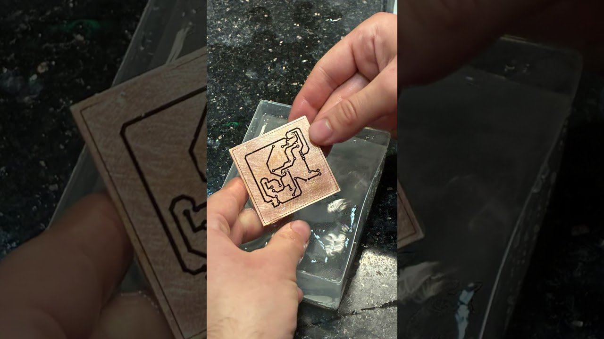
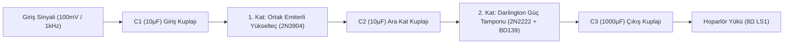
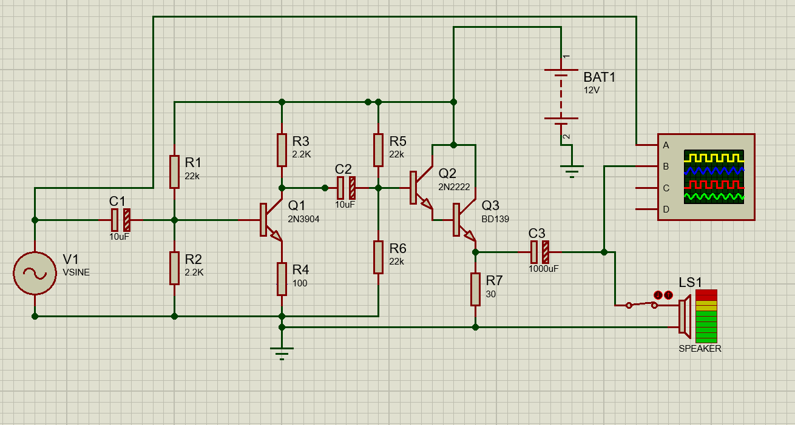
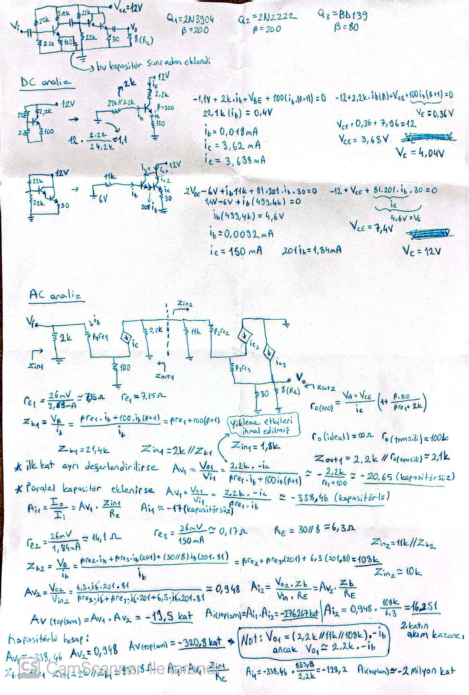
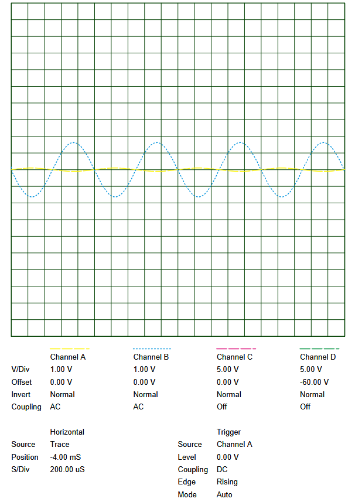

# 🔊 İki Katlı BJT Ses Yükselteç Devresi (Two-Stage BJT Audio Amplifier)

[](https://www.labcenter.com/)
[](#)
[](#)
[](#)
[](https://www.youtube.com/shorts/F1tf_s04gNs)

Bu proje; teorik küçük sinyal analizinden başlayarak şematik tasarım, SPICE osiloskop simülasyonu, tek yüzlü PCB çizimi ve **kimyasal asit banyosu yöntemiyle fiziksel baskı devre imalatına** kadar uzanan **iki katlı analog ses yükselteç (audio amplifier)** çalışmasını içermektedir.

---

## 🛠️ Fiziksel Donanım İmalatı ve Canlı Video

Tasarımı tamamlanan baskı devre, toner transfer yöntemi ve kimyasal bakır eritme (asit banyosu) kullanılarak tek yüzlü pertinaks plaket üzerine fiziksel olarak üretilmiştir.

<p align="center">
  <a href="https://www.youtube.com/shorts/F1tf_s04gNs" target="_blank">
    
  </a>
  <br>
  <em>Şekil 1: Asit banyosundan çıkarılarak temizlenmiş fiziksel bakır baskı devre plaketi.</em>
  <br><br>
  <a href="https://www.youtube.com/shorts/F1tf_s04gNs" target="_blank">
    
  </a>
</p>

> 📺 **Baskı Devre Yapım Videosu:** Yukarıdaki fotoğrafa tıklayarak veya [YouTube Shorts: Amfi Devresi Yapım](https://www.youtube.com/shorts/F1tf_s04gNs) bağlantısı üzerinden baskı devrenin imalat sürecini izleyebilirsiniz.

---

## 📑 Devre Blok Şeması ve Çalışma Mimarisi

Devre iki temel fonksiyonel kattan meydana gelmektedir:
1. **1. Kat (Gerilim Kazancı - CE):** 2N3904 NPN BJT transistör ile gerilim bölücülü kutuplama (voltage divider bias) kullanılarak tasarlanmış Ortak Emiterli (Common Emitter) yükselteç. Girişteki zayıf ses sinyalini genlik olarak yükseltir.
2. **2. Kat (Akım/Güç Tamponu - Darlington CC):** 2N2222 ve BD139 transistörlerinden oluşan Darlington çifti ile sürülmüş Ortak Kollektörlü (Common Collector / Emitter Follower) katı. Gerilim kazancı yaklaşık 1 olup, $8\Omega$ hoparlörü sürebilmek için gereken yüksek akım ve güç kazancını sağlar.



---

## ⚡ Şematik Tasarım ve Bileşen Listesi

<p align="center">
  
  <br>
  <em>Şekil 2: Proteus ISIS üzerinde modellenen iki katlı amfi devre şeması.</em>
</p>

### Kullanılan Bileşenler:

| Bileşen | Değer / Model | Fonksiyon |
| :--- | :--- | :--- |
| **Q1** | 2N3904 (NPN) | 1. Kat Küçük Sinyal Gerilim Yükselteci ($\beta \approx 200$) |
| **Q2** | 2N2222 (NPN) | Darlington Çifti Ön Sürücü Transistörü ($\beta \approx 200$) |
| **Q3** | BD139 (NPN) | Darlington Çifti Güç Transistörü ($\beta \approx 80$, TO-126) |
| **R1, R2** | $22\text{ k}\Omega$, $2.2\text{ k}\Omega$ | 1. Kat Gerilim Bölücü Kutuplama Dirençleri |
| **R3** | $2.2\text{ k}\Omega$ | 1. Kat Kollektör Yük Direnci ($R_C$) |
| **R4** | $100\ \Omega$ | 1. Kat Emiter Dejenerasyon / Kararlılık Direnci ($R_E$) |
| **R5, R6** | $22\text{ k}\Omega$, $22\text{ k}\Omega$ | 2. Kat Simetrik Gerilim Bölücü Dirençleri ($V_{TH} = 6\text{V}$) |
| **R7** | $30\ \Omega$ (Min. 1W) | 2. Kat Darlington Emiter Polarizasyon Direnci |
| **C1, C2** | $10\ \mu\text{F}$ | Giriş ve Ara Kat DC Bloklama / AC Kuplaj Kondansatörleri |
| **C3** | $1000\ \mu\text{F}$ | Hoparlör DC Koruma ve Düşük Frekans Çıkış Kuplaj Kondansatörü |
| **LS1** | $8\ \Omega$ | Hoparlör (Akustik Çıkış Yükü) |
| **BAT1** | $12\text{ V}$ | Tek Kaynak DC Güç Beslemesi |

---

## 📐 Teorik Analiz ve Matematiksel Hesaplar

El yazısı analiz notları (`docs/images/handwritten_calculations.jpeg`) üzerinden çıkarılan formüller ve hesaplanan DC/AC parametreleri:

<p align="center">
  
  <br>
  <em>Şekil 3: Kapsamlı el yazısı DC ve AC küçük sinyal analizi çalışma kağıdı.</em>
</p>

### 1. DC Çalışma Noktası (Q-Point) Analizi:
- **1. Kat ($Q_1$):**
  - Thevenin Gerilimi: $V_{TH1} = 12\text{V} \cdot \frac{2.2\text{k}}{22\text{k} + 2.2\text{k}} \approx 1.1\text{V}$
  - Thevenin Direnci: $R_{TH1} = 22\text{k} \parallel 2.2\text{k} = 2\text{ k}\Omega$
  - Baz Akımı: $I_{B1} = \frac{V_{TH1} - V_{BE}}{R_{TH1} + (\beta+1)R_4} = \frac{1.1 - 0.7}{2\text{k} + 201 \cdot 100} \approx 18.1\ \mu\text{A}$
  - Kollektör Akımı: $I_{C1} \approx 3.62\text{ mA}$
  - Kollektör ve Emiter Gerilimleri: $V_{E1} = 0.36\text{V}$, $V_{C1} = 4.04\text{V}$, $V_{CE1} = 3.68\text{V}$ (Aktif bölge doğrulanmıştır).

- **2. Kat ($Q_2 + Q_3$ Darlington):**
  - Thevenin Eşdeğeri: $V_{TH2} = 6.0\text{V}$, $R_{TH2} = 11\text{ k}\Omega$
  - Darlington Toplam Akım Kazancı: $\beta_{tot} \approx (\beta_2+1)(\beta_3+1) = 201 \cdot 81 = 16.281$
  - Baz Akımı: $I_{B2} \approx \frac{6\text{V} - 1.4\text{V}}{11\text{k} + 16281 \cdot 30\Omega} \approx 9.2\ \mu\text{A}$
  - Çıkış Emiter Akımı: $I_{E3} \approx 150\text{ mA}$
  - Çıkış DC Gerilimleri: $V_{E3} \approx 4.5\text{V}$, $V_{CE3} = 12\text{V} - 4.5\text{V} = 7.5\text{V}$

### 2. AC Küçük Sinyal Kazanç Analizi:
- Dinamik emiter dirençleri:
  $$r_{e1} = \frac{26\text{ mV}}{3.64\text{ mA}} \approx 7.15\ \Omega, \quad r_{e2} \approx 14.1\ \Omega, \quad r_{e3} \approx 0.17\ \Omega$$
- 2. Katın Darlington Giriş Empedansı ($Z_{in2}$):
  $$Z_{b2} \approx \beta_2 [r_{e2} + \beta_3 (r_{e3} + R_7 \parallel R_L)] \approx 108\text{ k}\Omega \implies Z_{in2} = 11\text{k} \parallel 108\text{k} \approx 10\text{ k}\Omega$$
- **1. Kat Gerilim Kazancı (Yükleme Etkisi Dahil):**
  1. katın efektif AC kollektör yükü $R_C \parallel Z_{in2} = 2.2\text{k} \parallel 10\text{k} \approx 1.8\text{ k}\Omega$ olur.
  $$A_{v1} = -\frac{R_C \parallel Z_{in2}}{r_{e1} + R_4} = -\frac{1800\ \Omega}{7.15\ \Omega + 100\ \Omega} \approx -16.8$$
- **2. Kat Gerilim Kazancı ($A_{v2}$):**
  $$A_{v2} = \frac{R_7 \parallel R_L}{r_{e3} + (R_7 \parallel R_L)} \approx 0.95$$
- **Toplam Gerilim Kazancı:**
  $$A_v(\text{toplam}) = A_{v1} \cdot A_{v2} \approx (-16.8) \cdot 0.95 \approx \mathbf{-16\text{ kat}}$$

---

## 📊 Simülasyon ve Osiloskop Sonuçları

Proteus sanal dijital osiloskobu (DSO) üzerinden $100\text{ mV}$ tepe genlikli $1\text{ kHz}$ sinüs giriş sinyali uygulanarak devre test edilmiştir:

<p align="center">
  
  <br>
  <em>Şekil 4: Proteus DSO osiloskop ekranı (Sarı: Giriş sinyali 100mV/1V div, Mavi: Çıkış sinyali 1.4V peak / 2.8Vpp).</em>
  <br>
  <em>Tam rapor: <a href="docs/oscilloscope_report.pdf">docs/oscilloscope_report.pdf</a></em>
</p>

- **Kanal A (Giriş):** $100\text{ mV}$ tepe değerli $1\text{ kHz}$ sinüs dalgası.
- **Kanal B (Çıkış):** Tepe değeri $\approx 1.4\text{ V}$ ($2.8\text{ V}_{pp}$), faz terslenmiş (Ortak emiterli kat nedeniyle $180^\circ$ faz farkı).
- **Ölçülen Kazanç:** $\frac{1.4\text{ V}}{0.1\text{ V}} \approx \mathbf{14 - 15\text{ kat}}$.
- Teorik yükleme hesabı ile simülasyon sonucu **tam bir uyum** göstermektedir.

---

## ⚠️ Kritik Donanım ve Güvenlik Notları

Devreyi fiziksel olarak kuracak veya çoğaltacak geliştiricilerin dikkat etmesi gereken önemli noktalar:

1. **$R_7$ Güç Direnci ($30\ \Omega$):**
   - DC durumda $R_7$ üzerinden sürekli $150\text{ mA}$ akım akmaktadır. Harcanan güç:
     $$P = I^2 \cdot R = (0.15\text{ A})^2 \cdot 30\ \Omega = 0.675\text{ W}$$
   - Standart çeyrek vatlık ($0.25\text{W}$) dirençler aşırı ısınıp yanar. Bu nedenle $R_7$ olarak **en az 1W veya 2W taş/metal film direnç** kullanılmalıdır.
2. **$Q_3$ (BD139) Transistör Soğutucusu:**
   - $Q_3$ üzerinde harcanan statik güç $P = V_{CE} \cdot I_C \approx 7.5\text{V} \cdot 0.15\text{A} \approx 1.125\text{ W}$ seviyesindedir.
   - TO-126 kılıfındaki BD139 transistörüne aşırı ısınmayı önlemek ve termal hasarı engellemek için mutlaka **küçük bir alüminyum soğutucu (heatsink)** monte edilmelidir.
3. **Emiter Baypas Kapasitörü Neden Kullanılmadı?**
   - $R_4$ ($100\Omega$) direncine paralel baypas kapasitörü bağlandığında kazanç 300 katın üzerine çıkmakta ve $100\text{mV}$ girişte $12\text{V}$ besleme sınırları aşılarak çıkış tamamen kırpılmaktadır (clipping). Bozulmasız ve doğrusal ses çıkışı için $R_4$ dejenerasyon direnci kapasitörsüz bırakılmıştır.

---

## 📂 Proje Dizin Yapısı

```text
ciftKatli-amfiDevresi/
├── .gitignore                      # Proteus geçici ve yedek dosyalarını dışlama kuralları
├── README.md                       # Kapsamlı teknik dokümantasyon
├── amfi(SON).pdsprj                # Proteus ISIS & ARES ana tasarım dosyası
├── amfi.pdsprj                     # Alternatif / temel Proteus proje dosyası
├── amfi(ilkkat).pdsprj             # Yalnızca 1. katın (CE) izole Proteus modeli
├── amfi(SON).DO                    # ARES otomatik çizim/router komut dosyası
├── amfi(SON).EDF                   # ARES Specctra / Electra netlist dosyası
└── docs/
    ├── oscilloscope_report.pdf     # Proteus DSO osiloskop vektör çıktısı
    ├── pcb_mask_panelized.pdf      # Asit baskıya hazır 4x4 panelize PCB kalıbı
    └── images/
        ├── circuit_schematic.png   # Devre şeması görseli
        ├── oscilloscope_output.png # Osiloskop dalga şekli görseli
        ├── pcb_etching_hardware.jpg# Asit banyosu baskı devre görseli (YouTube kapak)
        └── handwritten_calculations.jpeg # Teorik DC/AC el analizi notları
```

---

## 📜 Lisans

Bu proje [MIT Lisansı](LICENSE) kapsamında açık kaynak olarak paylaşılmıştır. Eğitim ve akademik çalışmalarda kaynak gösterilerek serbestçe kullanılabilir.
